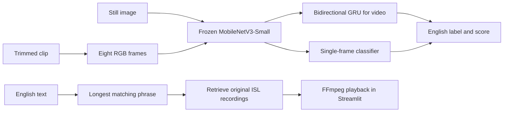

# SignSpeak

SignSpeak helps an Indian Sign Language (ISL) signer and an English reader exchange supported words and phrases. A signer can upload a trimmed recording to identify an unfamiliar sign. An English reader can enter a phrase to see a person signing it. The Streamlit application runs both workflows locally.

| Mode | Input | Output |
| --- | --- | --- |
| Listener | One image or trimmed video per isolated sign, up to 12 files in signing order | English labels and model scores, uncertain suggestions, optional browser speech |
| Communicator | Up to 240 characters of English text | Recorded ISL sentence or sign clips in input order, with gaps marked for unsupported words |

## How the application works



The Listener worker loads its checkpoint on an NVIDIA GPU and processes uploads separately from the dashboard. The Communicator tokenises English text and checks the longest dictionary phrase at each position. A whole-sentence match preserves the original signer's transitions. When all terms match, FFmpeg joins the clips at 640 × 480 and 25 fps. Partial matches display individual recordings and the unmatched words.

## 1. Install the project

The commands below use Windows PowerShell, 64-bit Python 3.11 and an NVIDIA driver compatible with the pinned CUDA 12.6 PyTorch wheels. Run the commands from the repository root in the same shell.

```powershell
git clone --branch SignSpeak https://github.com/Prashanth7829/SignSpeak.git
cd SignSpeak
py -3.11 -m venv .venv
$python = '.\.venv\Scripts\python.exe'
& $python -m pip install -r requirements.txt
& $python -c "import torch; print(torch.__version__, torch.cuda.is_available())"
```

The last value should be `True` for Listener and training. PyTorch and torchvision implement the model. OpenCV and NumPy decode and store frames. pandas, PyArrow and openpyxl read annotations. Streamlit provides the interface, imageio-ffmpeg supplies the video encoder and MediaPipe supports the earlier landmark pilot.

## 2. Obtain the recordings and annotations

| Source | What to download | Local destination |
| --- | --- | --- |
| [INCLUDE on Zenodo](https://zenodo.org/records/4010759) | All category ZIP parts for the full vocabulary. Keep their published file names and leave them compressed. | Directly inside `dataset/` |
| [AI4Bharat INCLUDE metadata](https://huggingface.co/datasets/ai4bharat/INCLUDE/tree/main/data) | Training, validation and test Parquet files. The inspection script below downloads them. | `dataset/include_metadata/` |
| [ISL-CSLTR version 1](https://data.mendeley.com/datasets/kcmpdxky7p/1) | The corpus ZIP containing the sentence recordings and annotation workbook. If you downloaded the outer bundle, extract the inner ZIP. Preserve the spelling shown here. | `dataset/raw/ISL-CSLTR/ISL_CSLRT_Corpus.zip` |

The recorded installation used about 57 GB of INCLUDE archives and 9 GB for the sentence archive. Allow additional disk space for the local cache. The category downloader verifies the archive checksum. For example, run `& $python dataset/download_include_archives.py Greetings` to fetch the Greetings category.

```powershell
& $python dataset/inspect_include50.py
& $python verify_environment.py
& $python dataset/build_csltr_manifest.py
& $python dataset/split_csltr_manifest.py
& $python dataset/audit_csltr_video_duplicates.py
& $python dataset/clean_csltr_duplicates.py
& $python -m signspeak.corpus
```

The environment check expects the Seasons archive. The sentence scripts match workbook rows and glosses to archive members, split sentence groups and use video hashes to clean duplicates. Their final output is `dataset/annotations/csltr_clean_manifest.csv`. The corpus builder joins full INCLUDE annotations to archive paths, excludes overlapping INCLUDE-50 rows and rejects conflicting labels. For matching duplicate signatures it reserves test copies before validation and training.

OpenCV samples eight frame indices between 10% and 90% of each clip, converts them to RGB and resizes them to 96 × 96. Each clip produces a NumPy array in `signspeak/artifacts/corpus/samples/`. The builder saves the successfully processed archive members, labels and split assignments in `catalog.json`. Completed arrays are reused on restart.

## 3. Train the full Listener

```powershell
$weights = 'signspeak/artifacts/torch/hub/checkpoints'
New-Item -ItemType Directory -Force $weights | Out-Null
Invoke-WebRequest 'https://download.pytorch.org/models/mobilenet_v3_small-047dcff4.pth' -OutFile "$weights/mobilenet_v3_small-047dcff4.pth"
& $python -m signspeak.full_model
```

Training uses isolated INCLUDE signs. ISL-CSLTR supplies playback examples. The encoder resizes frames to 160 × 160, applies ImageNet normalisation and pools features into 2,304 values per frame. A learned projection reduces these to 192 features. A bidirectional GRU reads the sequence and its averaged outputs feed the video classifier. A separate head classifies individual frames.

The trainer freezes the visual encoder and trains the other layers for 45 epochs with AdamW, learning rate 0.0006, batch size 48 and seed 42. The objective adds video cross-entropy and 0.35 times frame cross-entropy. Validation video loss selects the checkpoint. Validation predictions determine separate video and image confidence thresholds. The trainer saves `include.pt` and a fresh `include.json` in `signspeak/artifacts/corpus/`.

The recorded run selected epoch 43 and recognised 689 of 816 held-out videos across 262 signs (84.4%). Accuracy across sampled test frames was 43.6%. These results describe isolated clips from the project split. [Recorded evaluation](signspeak/artifacts/corpus/include.json)

## 4. Run and use the dashboard

```powershell
& $python -m streamlit run signspeak/app.py
```

Open the local URL printed by Streamlit. In **Listener**, upload a JPG, JPEG, PNG, WebP, MP4, MOV, AVI, MKV or WebM file and select **Recognize signs**. Use one trimmed clip per sign. For a sequence, upload in signing order. Low scores appear as suggestions. Enable English speech to use the browser's available voices.

In **Communicator**, enter **He is going into the room, hello** and select **Play signs**. With the prepared full catalog, this matches a sentence and a greeting. Expand the vocabulary browser to find supported inputs. The recorded installation offered 262 isolated signs and 98 complete sentences.

If you already have a trained installation, restore its matching `include.pt`, `catalog.json` and original archives in their expected locations. The inference workflow can then start at step 4. The frame cache and ImageNet weights are needed to rebuild training.

## Repository guide

| Path | Purpose |
| --- | --- |
| `signspeak/app.py`, `worker.py` | Streamlit views, upload validation and the isolated recognition process |
| `signspeak/settings.py` | Data root, checkpoints and accepted media formats |
| `signspeak/corpus.py`, `full_model.py` | Build the RGB cache, train, evaluate and load the full recogniser |
| `signspeak/media.py`, `dictionary.csv` | Build the playback dictionary, match text and assemble clips |
| `signspeak/recognition.py`, `train.py` | Earlier five-sign MediaPipe landmark recogniser and trainer |
| `dataset/*.py` | Download, preparation and audit utilities. The iSign exploration scripts are independent of the application workflow. |
| `preprocessing/`, `sign_dictionary/` | Pilot landmark extraction and dictionary construction |
| `verify_environment.py`, `requirements.txt` | Environment diagnostics and pinned Python dependencies |

## Optional five-sign pilot

After downloading the Seasons and Greetings archives and INCLUDE metadata, run the following from the repository root. The app selects the full checkpoint when present and otherwise looks for the pilot checkpoint at `signspeak/artifacts/recognizer.pt`.

```powershell
& $python dataset/prepare_seasons_pilot.py
& $python dataset/prepare_greetings_pilot.py
& $python dataset/build_pilot_manifest.py
& $python preprocessing/extract_pilot_landmarks.py
& $python -m signspeak.train
```

## Configuration and troubleshooting

| Symptom | What to check |
| --- | --- |
| CUDA unavailable | Use the project interpreter and verify the CUDA-enabled wheels and NVIDIA driver. The environment check's `--cpu` option tests CPU arithmetic only. |
| Missing sentence manifest or archive | Check the inner ZIP name and run the four sentence annotation scripts in the order above. |
| Empty catalog or missing signs | Check that the full category ZIP files are directly inside the dataset root and that the split filenames start with `train-`, `val-` and `test-`. |
| Missing model | Prepare the cache, download the encoder weights and train, or restore a matching checkpoint. Launching Streamlit alone does not train a model. |
| Archives kept elsewhere | Set `$env:SIGNSPEAK_DATASET` to the absolute data directory before running the application or corpus builder. The standalone dataset preparation scripts use the directory containing the scripts. Prepare in the documented layout first, then preserve relative archive paths when relocating data. |
| Playback gaps or uncertain predictions | Search the displayed vocabulary and supply one clear, trimmed video per sign. Independent photographs and continuous signing require separate evaluation. |
